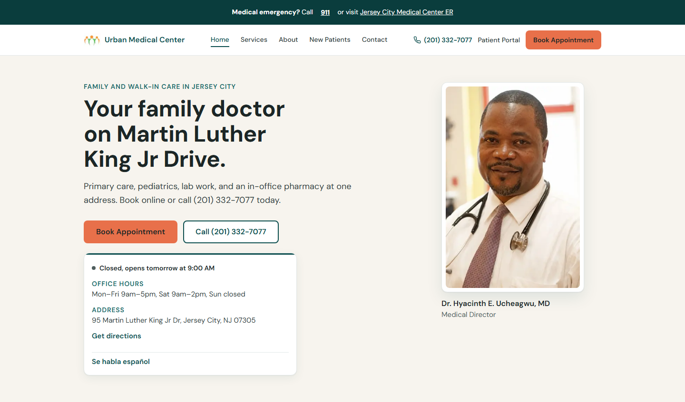

# Urban Medical Center website

The public website for Urban Medical Center, a family and pediatric practice in Jersey City, NJ. It runs in production at [www.urbanmds.com](https://www.urbanmds.com).



## About the project

This is a rebuild of the clinic's old static HTML site ([urban-medical-center](https://github.com/kenechi-ucheagwu/urban-medical-center)) as a Next.js app. I work in IT operations and billing at the practice, and I built and maintain the site.

The patients skew older, many use phones, and most want one of three things: book a visit, call the office, or find the building. So every page puts those actions one tap away. The clinic facts (hours, address, phone, accepted insurance) live in one file, so a change to the hours or the insurance list shows up the same way on every page.

## Features

- **Booking and calling from anywhere.** Book and Call buttons in the header of every page, a fixed Book / Call bar on phones, and directions on the home, contact and care pages. Booking links open the practice's Elation online scheduler directly.
- **Open-now status.** Computed in New York time from a single schedule, with support for one-off closure dates.
- **Notice banner.** A dated site-wide banner for closures or one-day service changes. It hides itself after its last day, so nobody has to remember to take it down.
- **Care pages.** Services, pediatrics, family medicine, walk-in care, weight loss, new patients, about, contact and privacy.
- **Printable intake packet.** A static HTML packet with print styles that patients fill in, print, and bring in or fax back. Nothing typed into it leaves the browser.
- **Contact form.** A Next.js route handler sends mail through the Gmail API with a Google service account. It has a honeypot field, a minimum fill time, a per-IP rate limit, length caps, an Origin allowlist and checks against mail header injection. The confirmation email is generic on purpose, so the form can't be used to send arbitrary text from the practice's address.
- **Local search.** schema.org JSON-LD for the clinic and the physician, FAQ markup built from the same data as the visible FAQ, canonical URLs and Open Graph tags on every page, a sitemap and robots.txt.
- **Accessibility.** Skip link, visible focus styles, reduced-motion support for every animation, content that is never hidden on first paint, and larger, darker text for older readers (WCAG AA contrast).
- **Performance.** Every page except the contact API is prerendered. The Google Map loads only when someone clicks Show map, which keeps 500 to 700 KB of Google scripts and Google cookies off the page by default. Fonts are self-hosted through `next/font`.
- **Measurement.** Vercel Analytics and Speed Insights, plus one delegated click listener that records Book, Call, Directions and Forms clicks by page section.

## Stack

- Next.js 16 (App Router), React 19, TypeScript
- Tailwind CSS 4
- `googleapis` (Gmail API) for the contact form
- Vercel hosting, Analytics and Speed Insights
- pnpm

## Run it locally

You need Node.js 20 or newer and pnpm.

```bash
pnpm install
pnpm dev
```

Then open http://localhost:3000.

For a production build, run `pnpm build` and then `pnpm start`. `pnpm lint` runs ESLint.

The contact form needs a Google service account key with domain-wide delegation for Gmail send, passed as JSON in the `GOOGLE_SERVICE_ACCOUNT_KEY` environment variable. Without it, the form shows a friendly error and the rest of the site works normally. `.env*` files are git-ignored, so a local key stays local.

The clinic and physician NPI numbers in the structured data are read from `NEXT_PUBLIC_CLINIC_NPI` and `NEXT_PUBLIC_PHYSICIAN_NPI` rather than kept in the code. Copy `.env.example` to `.env.local` to set them; if they are empty, the NPI identifiers are left out.

## Project layout

```
src/app/            pages, root layout, sitemap, robots, contact API route
src/components/     header, footer, booking buttons, open status, FAQ, map, notice banner
src/lib/clinic.ts   one source for hours, address, phone, booking links and insurance wording
src/lib/seo.ts      shared metadata and JSON-LD helpers for the care pages
public/             images, the printable intake packet, a self-hosted font for it
```

## Data and privacy

This repo holds no patient data. The only details in it are the clinic's public listing facts (address, phone, fax, office email, hours, the physician's name, accepted insurance) and links to the clinic's public Elation booking page and patient portal. Contact form messages go straight to the office inbox; the site does not store them.

## What's next

- Spanish versions of the main pages. The front desk is bilingual, and only a few lines are in Spanish today.
- Automated checks before each deploy: Playwright and axe over the key pages for broken links, accessibility problems and the open-now logic.
- Preview deploys for every pull request.
- A proper 1200x630 image for link previews.

## Ownership

The code is shared so people can read it. The clinic's name, logo and photos, and the insurer logos, belong to their owners and are included only so the site renders as it does in production.
